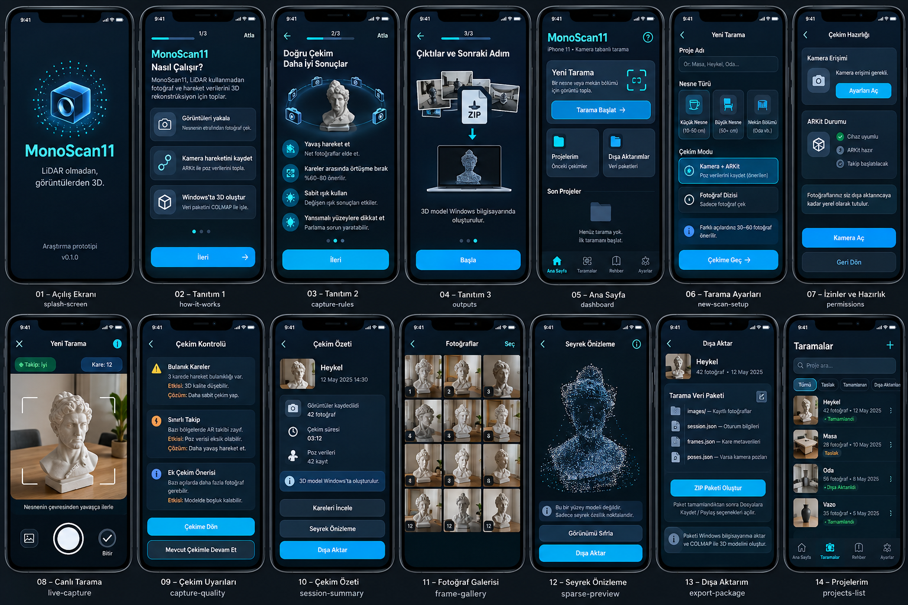
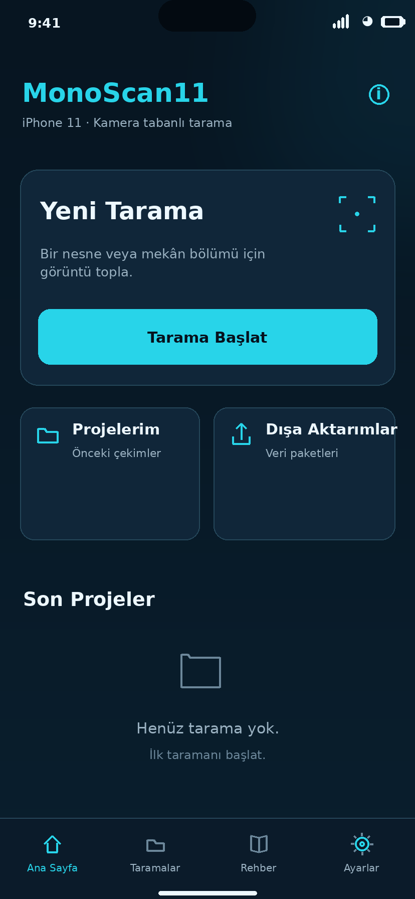
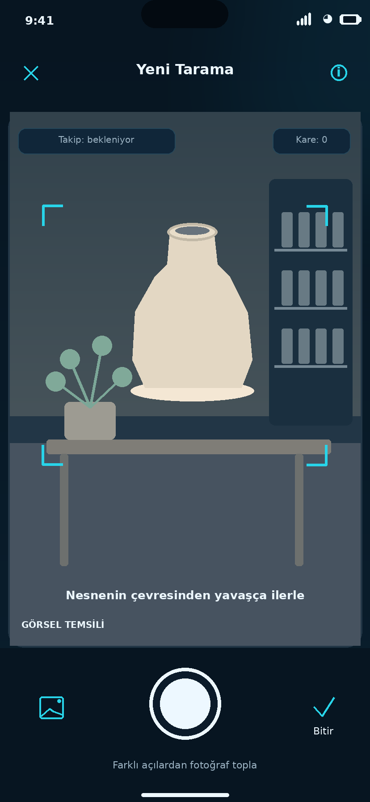
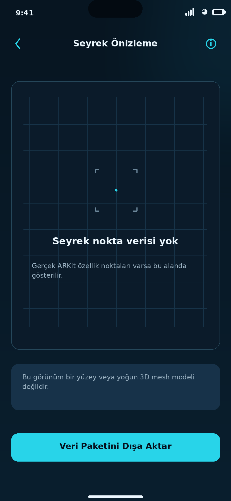
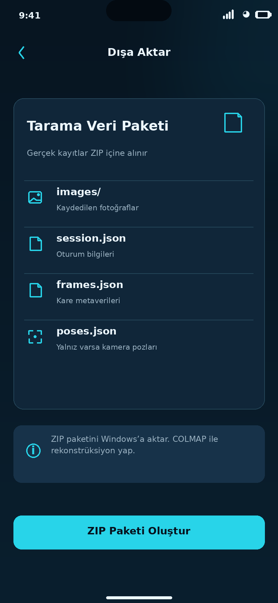

# MonoScan11

> **Native SfM geliştirme dalı (N0–N3):** Bu dal COLMAP'sız, deneysel bir fotoğraf tabanlı 3B işlem hattına geçiş içindir. Henüz gerçek iPhone/Windows kabulü veya metrik doğruluk kanıtı yoktur. Önce [geçiş mimarisini](docs/COLMAP_FREE_ARCHITECTURE.md) okuyun.

**LiDAR'sız iPhone 11 için kamera tabanlı 3D rekonstrüksiyon araştırma projesi**

**Sürüm:** `v0.2.0-alpha` · **Lisans:** MIT · **Çalışma ilkesi:** yerel/offline-first · **Durum:** Windows Python araçları ve taşınabilir Swift veri/ZIP çekirdeği test edildi; SwiftUI kaynak ekranları hazır; Xcode derlemesi ve gerçek cihaz kabulü bekliyor.

MonoScan11, fiziksel LiDAR sensörünü taklit etmez. Birden fazla bakış açısından fotoğraf kullanarak görüntü eşleştirme, **Structure from Motion (SfM)**, **Multi-View Stereo (MVS)** ve üçgenleme (triangulation) teknikleriyle 3D geometri üretmeyi hedefler. Bu geliştirme dalında rekonstrüksiyon için harici COLMAP kurulumu gerekmez; native SfM yalnızca deneysel seviyededir. LiDAR donanımı veya garantili metrik doğruluk gerekmez; ölçüm iddiaları bağımsız değerlendirmeye tabidir.

## Gerçek durum (yayınlamadan önce okuyun)

| Bölüm | Durum | Kanıt |
|---|---|---|
| Windows / Linux Python araçları | Kaynak kodu hazır; test edildi | `python -m unittest discover -s tests -v` |
| Sentetik iki bakışlı derinlik hesabı | Tamamlandı, deterministik demo | `python tools/monoscan.py demo demo-output` |
| Fotoğraf / ARKit `session.json` denetimi | Otomatik test edildi | JPEG/PNG başlık, boyut, matris, poz, güvenli dosya adları |
| MonoScan11 native SfM motoru | İlk prototip kodlandı, gerçek veri bekliyor | N1–N3 sentetik testler; gerçek fotoğraf / ölçüm kabulü yok |
| Gerçek iPhone 11 fotoğraflarından 3D rekonstrüksiyon | **Bekliyor** | Yeni native pipeline henüz gerçek iPhone/Windows ortamında kabul edilmedi |
| SwiftUI arayüz / iOS ARKit uygulaması | 18 ekran kodlandı; **Xcode derlenmedi** | Kaynak parse + Swift Foundation testleri; macOS/Xcode ve iPhone kabulü en sonda |
| iOS ZIP paketinin Windows uyumu | Sentetik görüntülerle PASS | Swift ZIP32 CRC -> Python `validate` zinciri; gerçek iPhone verisi değil |
| 3D modelin ölçüm doğruluğu | **Doğrulanmadı** | Gerçek referans metre/lazer ölçer karşılaştırması yok |

> **Sınır:** Sentetik demodaki çok küçük hata, ideal ve gürültüsüz geometrinin matematiksel sonucudur. iPhone 11'in gerçek tarama doğruluğu değildir. ARKit'in seyrek izleme noktaları LiDAR nokta bulutu değildir.

## iPhone 11 arayüz konsepti — 18 ekran

> **Tasarım maketidir, gerçek iPhone ekran görüntüsü değildir.** SwiftUI kaynak prototipi Xcode ile henüz derlenmedi; canlı kamera, ARKit takibi, 3D önizleme ve ölçümler fiziksel cihazda kabul edilmedi. Görseller planlanan deneyimi tanımlar; çalışan uygulama özelliklerinin kanıtı değildir.

[](docs/ui/README.md)

18 ekranlık detaylı konsept arşivi: [toplu önizleme](assets/screenshots/contact-sheet.png).

| Ana Sayfa | Canlı Tarama | Seyrek Önizleme | Windows'a Dışa Aktarım |
|---|---|---|---|
| [](assets/screenshots/05-home-dashboard.png) | [](assets/screenshots/08-live-capture-screen.png) | [](assets/screenshots/12-sparse-preview.png) | [](assets/screenshots/13-export-package-screen.png) |

**[Bütün 18 ekranı, wireframe TXT sözleşmesini ve arayüz akışını incele](docs/ui/README.md)** · [SwiftUI uygulama ve test durumu](docs/IOS_UI_IMPLEMENTATION.md) · [PNG koleksiyonu](assets/screenshots/README.md) · [Üretici kaynak kodu](scripts/generate_ui_mockups.py). iPhone'da yoğun nokta bulutu/mesh üretildiğini ima eden bir ekran bulunmaz. Seyrek önizlemede gerçek ARKit verisi yoksa boş durum gösterilir.


## SwiftUI uygulama kaynakları (v0.2.0-alpha)

`ios/MonoScan11/` klasöründe 18 ekran ailesinin gerçek SwiftUI kaynak kodu, proje deposu (`ScanStore`), kamera/ARKit oturumu (`ScanEngine`), oturum şeması (`ProjectRecord`) ve bağımsız ZIP yazıcısı (`ZIPStore`) bulunur. `project.yml` XcodeGen proje tanımıdır.

**Doğrulanan:** Python regresyon testleri; Linux'ta Swift sözdizimi ayrıştırması; Foundation tabanlı Swift çekirdeğinin derlenmesi ve test edilmesi; ZIP CRC ve `session.json` Windows Python doğrulayıcısı. **Doğrulanmayan:** SwiftUI için iOS SDK ile typecheck/build, XcodeGen proje üretimi, iPhone üzerinde kamera çalışması, gerçek ARKit ve gerçek 3D model.

`Fotoğraf Dizisi` seçeneği ve fotoğraf silme bu sürümde bilinçli olarak devre dışı tutulmuştur. Tam durum ve ekran listesi: [iOS UI uygulama notları](docs/IOS_UI_IMPLEMENTATION.md).

## GitHub'a ilk yükleme (Windows)

[GitHub deposu](https://github.com/seydivakkas/MonoScan11) henüz boşsa proje ZIP'ini açıp **`Publish-GitHub.cmd`** dosyasını çalıştırabilirsin. Bu betik `origin` adresini doğrular, `main` hedefine yalnız normal `git push` yapar (**force-push yoktur**). Git for Windows ve GitHub kimlik doğrulaması gerekir. Betiğin gerçek Windows kabul testi henüz yapılmadı; alternatif komutlar `docs/GITHUB_YAYIN.md` içindedir. GitHub Actions sonuçları yükleme sonrası kontrol edilmelidir.

## 1. Windows'ta hemen çalıştır

**Gereken:** Python 3.10 veya daha yeni. Temel komutlar için `pip install` gerekmez.

Klasörü ZIP'ten çıkardıktan sonra:

```powershell
cd MonoScan11
python -m unittest discover -s tests -v
python tools/monoscan.py demo demo-output
```

Alternatif: `Run-Tests.cmd` ve `Demo-Triangulation.cmd` dosyalarına çift tıkla. Demo şu dosyaları oluşturur:

- `demo-output/synthetic_points.ply` — iki sentetik görüntü konumundan üçgenlenmiş 117 nokta
- `demo-output/metrics.json` — gürültüsüz referansa göre MAE/RMSE, **gerçek cihaz metriği değil**

PLY dosyasını CloudCompare veya MeshLab gibi bir 3D görüntüleyici ile açabilirsin. Demo internet gerektirmez.

## 2. iPhone 11'in normal Kamera uygulamasıyla ilk gerçek fotoğraf deneyini hazırla

Mac ve Xcode **gerekmez**. Telefonunun arka 1× ana kamerasıyla, hareketsiz ve dokulu bir nesnenin etrafından **30–100 farklı açı** çek; ardışık karelerde yaklaşık %60–80 örtüşme hedefle. Nesneyi döndürmek yerine mümkünse kamerayı çevresinde gezdir; ışığı ve odağı sabit tut. Bulanıklık, ayna, dümdüz duvar, hareket eden insan ve sadece yerinde dönme SfM için sorunludur.

**Önemli iPhone ayarı:** Ayarlar → Kamera → Biçimler → **En Uyumlu** seçeneğini kullanarak mümkünse JPEG çek. HEIC dosyaları önce JPEG/PNG'ye dönüştür; dosyanın uzantısını elle değiştirmek dönüştürme değildir. Fotoğrafları Windows'a **orijinal boyutuyla**, yeniden ölçeklendirmeden aktar.

```text
C:\scan-data\ilk-nesne\
└── images\
    ├── IMG_0001.JPG
    ├── IMG_0002.JPG
    └── ...
```

Görüntüleri kontrol et:

```powershell
python tools/monoscan.py validate "C:\scan-data\ilk-nesne"
```

ARKit kaydı olmadan da bu yöntem çalışabilir; çünkü SfM kamera pozlarını fotoğraflardan tahmin eder. Bu, aynı fotoğraflar ile COLMAP'de gerçek başarılı model üretildiğinin kanıtı **değildir**; onu ayrıca çalıştırıp test edeceğiz.

## 3. MonoScan11 native SfM ile deneysel rekonstrüksiyon (Windows)

```powershell
python -m pip install -r requirements-native.txt
python tools/monoscan.py validate "C:\scan-data\ilk-nesne"
python tools/monoscan.py reconstruct "C:\scan-data\ilk-nesne" --mode photo-only --focal-px 1800
```

`1800` örnektir, **kendi görüntülerinize ait kalibrasyon değeri değildir**.
`session.json` içindeki gerçek `K` varsa `--focal-px` gerekmez.
Arşivin orijinal görüntü ve veri dosyaları hiçbir zaman üzerine yazılmaz.

İşlem başarıyla sonuçlanırsa `reconstruction/runs/run-*/` altında
`sparse.ply`, `cameras.json`, `tracks.json`, `summary.json` oluşur.
Üçten fazla fotoğrafta yalnız bir alt küme kaydedilebildiyse `PARTIAL` yazılır.
Gerçek veri, bağımsız ölçüm doğruluğu, dense MVS ve bundle adjustment **bekliyor**.

## 4. Deneysel yerel SfM mimarisi

```text
iPhone 11 RGB JPEG + (varsa) ARKit session.json
                 |
Windows MonoScan11 offline Python
                 |
  K/doğrulama -> SIFT eşleşmeleri -> RANSAC essential matrix
                 |
  İlk kamera çifti + triangulation -> artımlı PnP ve triangulation
                 |
   sparse.ply + cameras.json + tracks.json + summary.json
```

Bu dalda `PHOTO_ONLY` modu tamamlanmamış, **deneysel** bir SfM çekirdeğidir.
`session.json` içindeki K kullanılabilir, ancak ARKit pozları henüz N4
aşamasındaki poz-füzyonu için kullanılmamaktadır. Metrik ölçek bilinmez.
N5 Bundle Adjustment ve N6 yoğun MVS/mesh bu dalda yoktur.

## 5. Proje klasörleri

```text
.github/workflows/tests.yml         GitHub Actions (Windows + Ubuntu)
.github/ISSUE_TEMPLATE/             iOS ve gerçek sahne kabul iş listeleri
tools/monoscan.py                   validate / reconstruct / inspect / demo
tools/geometry.py                   Pinhole model + triangulation + sentetik demo
monoscan_core/                      Kamera, SIFT, epipolar doğrulama, SfM, yerel PLY\ntools/colmap_models.py              Yalnızca tarihsel eski çıktı okuyucusu, native motor kullanmaz
tests/                             Gerçek küçük PNG + sentetik COLMAP model fixture'ları
ios/MonoScan11/                     Henüz Xcode'da derlenmemiş SwiftUI/ARKit kaynakları
project.yml                         XcodeGen proje tarifi (Mac aşaması)
docs/SON_ASAMAYA_BIRAKILANLAR.md   Mac/Xcode ve saha işlerinin açık listesi
docs/VALIDATION_PLAN.md            Deney planı ve bağımsız metrikler
docs/GITHUB_YAYIN.md               Repo oluşturma/push/Release talimatları
```

## 6. GitHub'da yayımlama

Bu depo **kaynak kodu / alpha araştırma sürümü** olarak yayımlanabilir. Önce `Run-Tests.cmd` çalıştır; ardından [GitHub yayın rehberini](docs/GITHUB_YAYIN.md) uygula. Ana uygulamanın iPhone'da denenmiş olduğu iddiasında bulunma. GitHub Actions'da Windows ve Ubuntu testleri başarılı görünmeden `stable` etiketi kullanma.

**Plan ve sınırlamalar:** [Son aşamaya bırakılanlar](docs/SON_ASAMAYA_BIRAKILANLAR.md) · [Yol haritası](docs/ROADMAP.md) · [Doğrulama planı](docs/VALIDATION_PLAN.md) · [Mimari kararlar](docs/ARCHITECTURE.md)

## 7. Veri gizliliği, ticari kullanım ve atıf

- MonoScan11 kaynak kodu MIT lisanslıdır. COLMAP yeni çalışma yolunda kullanılmaz; OpenCV/NumPy ve diğer bağımlılıkların lisans ve dağıtım şartları sürümlemede ayrıca doğrulanmalıdır.
- Bulut, üyelik veya ücretli API zorunlu değildir. Açık kaynak/ücretsiz araçlar kurulunca çoğu işlem internetsiz yürütülebilir.
- Ev, oda, özel mekân fotoğraflarını veya `session.json` dosyalarını GitHub'a yüklemeyin. `scans/`, `datasets/` ve `reconstruction/` Git tarafından yok sayılır; bunun dışında farklı klasöre konan özel görüntüleri de kendiniz denetleyin.
- Bu ürün ölçüm sertifikalı bir profesyonel 3D lazer tarayıcı alternatifi değildir.

**Teknik dayanaklar:** [Apple ARKit ARWorldTrackingConfiguration](https://developer.apple.com/documentation/arkit/arworldtrackingconfiguration), [ARFrame.rawFeaturePoints](https://developer.apple.com/documentation/arkit/arframe/rawfeaturepoints), [COLMAP CLI](https://colmap.github.io/cli.html).
