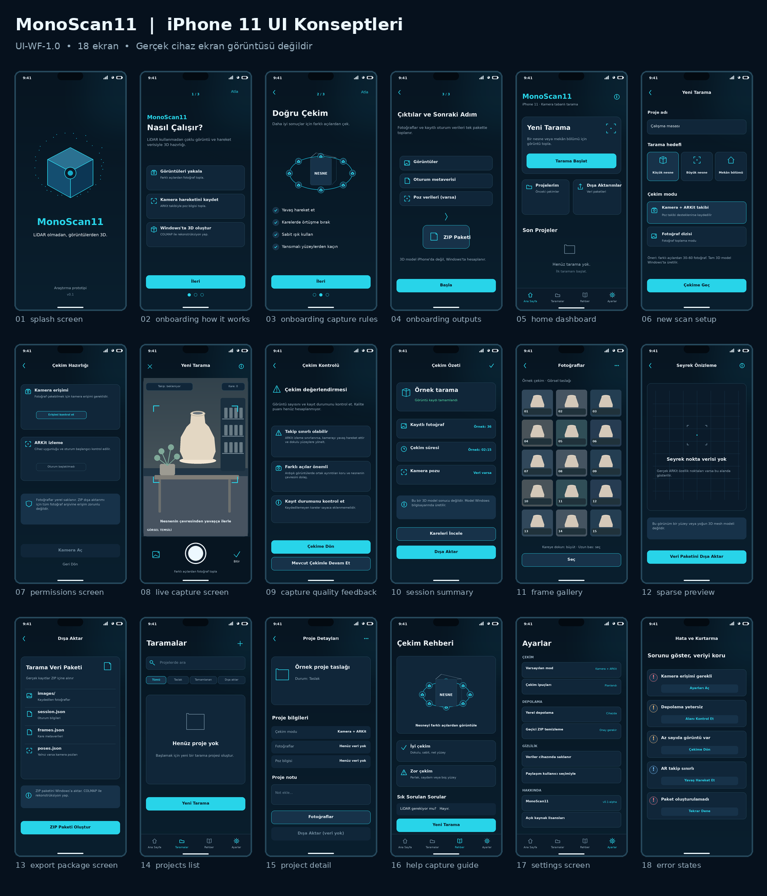

# MonoScan11 — iPhone 11 Arayüz Tasarım Koleksiyonu

**Durum: UI-WF-1.0 tasarım maketleri; derlenmiş uygulamadan veya gerçek iPhone'dan alınmış ekran görüntüleri değildir.** macOS/Xcode derlemesi, sensör verisi doğrulaması ve gerçek tarama kabulü plan gereği sonraki aşamalara bırakılmıştır.

## Onaylanan 14 ekranlık ana referans (değiştirilmemiş görsel)


Bu görsel UI-P2 SwiftUI kodlamasının birincil görsel referansıdır. Kalan dört ekran aynı tasarım diliyle ele alınır. Aşağıdaki 18 sayfalık önceki konsept galerisi ve metin şartnamesi ek tasarım kaynaklarıdır.



## Tasarım sözleşmesi

- [Sabit Türkçe wireframe metni](MonoScan11-iPhone11-Wireframe-v1.txt)
- [Makineyle okunabilir ekran manifesti](screens.json)
- Hedef cihaz: iPhone 11; dikey ekran; tasarım 414 × 896 pt / PNG 828 × 1792 px.
- Koyu lacivert, camgöbeği vurgular, Türkçe kopya, dört alt sekme.
- Bu görüntüler Pillow ile yerelde, düzenlenebilir kod üzerinden üretildi. **iOS SwiftUI prototipiyle otomatik senkronize değiller.**
- Sahte kapsama yüzdesi, LiDAR lazeri, tarama doğruluğu veya elde edilmemiş nokta bulutu gösterilmez. Veri olmayan sayfalarda boş durum gösterilir.
- Bazı maketler senaryo örneği içerir (ör. örnek tarama adı, 36 kare, çizim amaçlı nesne). Bunlar deney sonucu veya cihaz ölçümü değildir.

## Ekran galerisi

| 01–06 · Başlangıç | 07–12 · Toplama ve İnceleme | 13–18 · Yönetim ve Kurtarma |
|---|---|---|
| [01 Açılış](../../assets/screenshots/01-splash-screen.png) | [07 İzin kontrolü](../../assets/screenshots/07-permissions-screen.png) | [13 ZIP dışa aktarım](../../assets/screenshots/13-export-package-screen.png) |
| [02 Nasıl çalışır?](../../assets/screenshots/02-onboarding-how-it-works.png) | [08 Canlı tarama](../../assets/screenshots/08-live-capture-screen.png) | [14 Projelerim](../../assets/screenshots/14-projects-list.png) |
| [03 Çekim kuralları](../../assets/screenshots/03-onboarding-capture-rules.png) | [09 Çekim kontrolü](../../assets/screenshots/09-capture-quality-feedback.png) | [15 Proje detayı](../../assets/screenshots/15-project-detail.png) |
| [04 Çıktılar](../../assets/screenshots/04-onboarding-outputs.png) | [10 Çekim özeti](../../assets/screenshots/10-session-summary.png) | [16 Çekim rehberi](../../assets/screenshots/16-help-capture-guide.png) |
| [05 Ana sayfa](../../assets/screenshots/05-home-dashboard.png) | [11 Kare galerisi](../../assets/screenshots/11-frame-gallery.png) | [17 Ayarlar](../../assets/screenshots/17-settings-screen.png) |
| [06 Yeni tarama](../../assets/screenshots/06-new-scan-setup.png) | [12 Seyrek önizleme](../../assets/screenshots/12-sparse-preview.png) | [18 Hata durumları](../../assets/screenshots/18-error-states.png) |

## Önemli tasarım etkileşimleri

1. **Başlatma:** Proje adı ve çekim modu kontrol edilir; boş adla tarama başlamaz.
2. **İzin:** Kamera izni olmadan canlı ekran açılamaz; kullanıcı ayarlara yönlendirilir.
3. **Kayıt:** Sayaç yalnız başarıyla kaydedilen kareyle artar.
4. **Önizleme:** ARKit'in gerçekten kayıtlı `rawFeaturePoints` verisi yoksa nokta bulutu yerine boş durum gösterilir.
5. **Dışa aktarım:** Başarılı ZIP doğrulaması olmadan paylaşma ekranı gösterilmez.
6. **İşlem:** Tam SfM/MVS rekonstrüksiyonu iPhone ekranında değil Windows/COLMAP safhasında yapılır.

## PNG'leri yeniden üretme

```powershell
python -m pip install "Pillow>=10,<13"
python scripts/generate_ui_mockups.py
python -m unittest discover -s tests -v
```

`assets/screenshots/` içine 18 PNG + `contact-sheet.png` çıkar. Maket üretiminde Windows'ta Segoe UI/Arial, Linux'ta DejaVu Sans tercih edilir; ileride iOS uygulaması sistem fontu SF'yi kullanacak. PNG üretimi **tasarım oluşturma aracıdır**, iOS derleme veya gerçek cihaz testi değildir.

## Görsel kabul kriterleri

Her dosya 828 × 1792 px; ad ve sıralama `screens.json` ile eşleşmeli. Uygulama içeriği Türkçe, etiketler okunur, menüler genel tasarım sisteminde tutarlı olmalı. Gerçek olmayan donanım/kalite iddiası eklenmemeli. Özellikle 08 kameranın görsel temsili olduğunu, 11'in örnek fotoğraf karolarından oluştuğunu ve 12'nin veri yok boş durumu olduğunu dikkate al.

**Son aşama:** iOS kodunun derlenmesi, izinler/kamera/ARKit davranışının gerçek iPhone 11 üzerinde test edilmesi, ardından gerçek ekran görüntüleriyle bu maketlerin değiştirilmesi.
